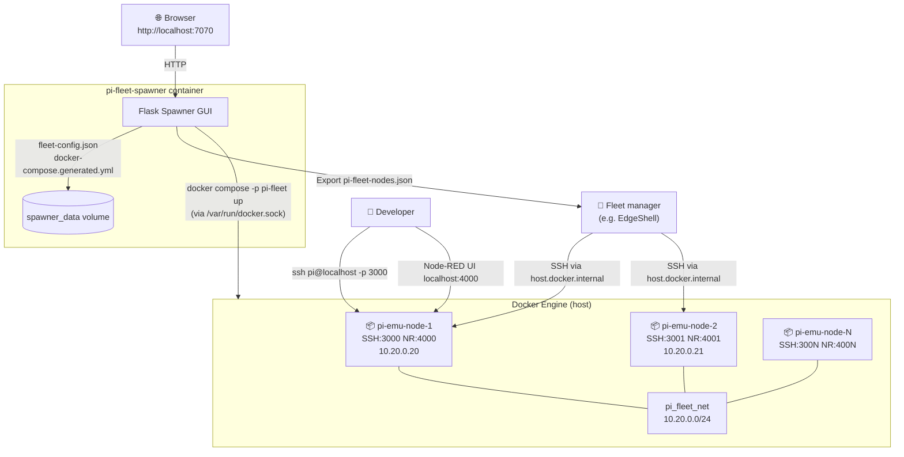
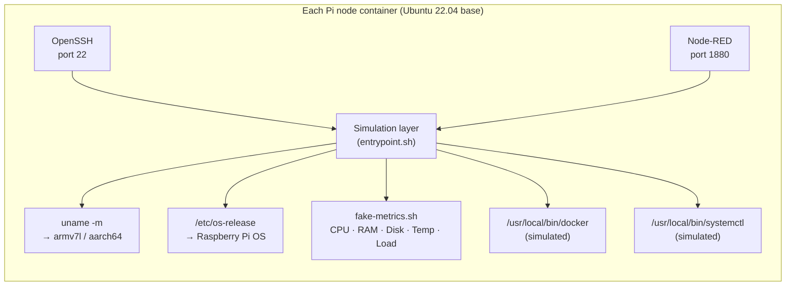
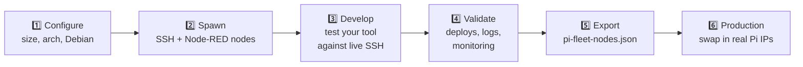
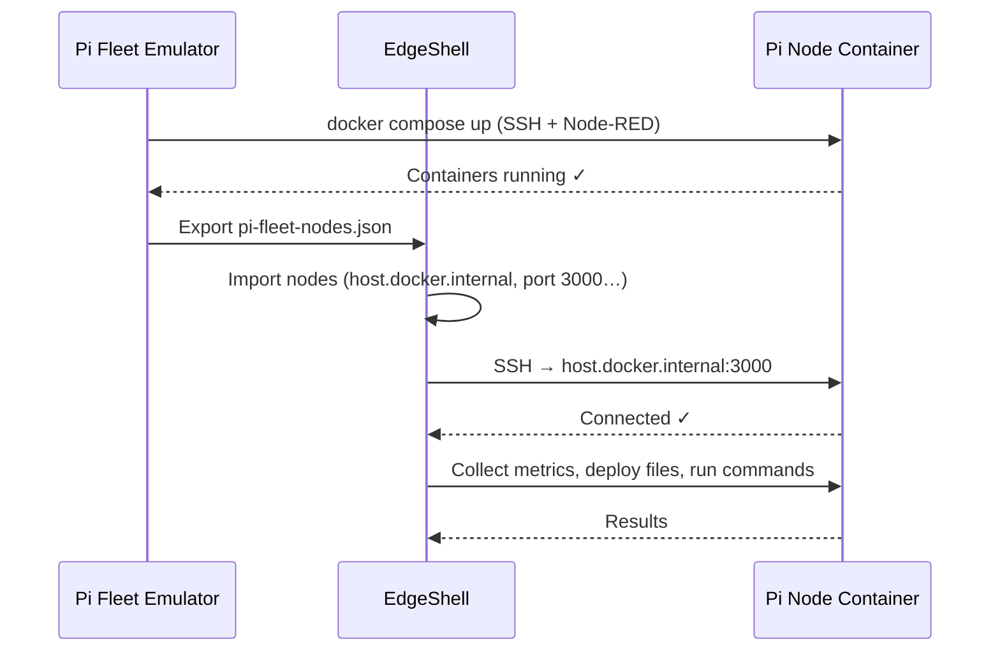
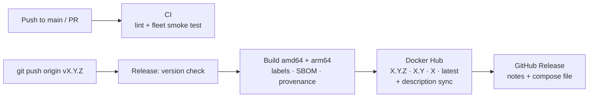

<div align="center">



### Spawn a realistic Raspberry Pi fleet in Docker - no hardware required.

A self-contained test bed for IoT deployment pipelines, fleet management tools and edge computing workflows.

<!-- Project -->
[](https://github.com/855princekumar/pi-fleet-emulator/actions/workflows/ci.yml)
[](https://github.com/855princekumar/pi-fleet-emulator/actions/workflows/release.yml)
[](https://github.com/855princekumar/pi-fleet-emulator/releases)
[](LICENSE-MIT)
[](LICENSE-APACHE)
[](https://github.com/855princekumar/pi-fleet-emulator/releases)
[](#contributing)
[](#quick-start)

<!-- Docker Hub -->
[](https://hub.docker.com/r/devprincekumar/pi-fleet-spawner)
[](https://hub.docker.com/r/devprincekumar/pi-fleet-spawner)
[](https://hub.docker.com/r/devprincekumar/pi-fleet-spawner)
[](https://hub.docker.com/r/devprincekumar/pi-fleet-node)
[](#quick-start)

<!-- What gets simulated -->
[](#what-each-node-simulates)
[](#fleet-configuration)
[](#fleet-configuration)
[](#fleet-configuration)

<!-- Stack -->
[](https://docs.docker.com/compose/)
[](https://www.python.org/)
[](https://flask.palletsprojects.com/)
[](https://nodered.org)
[](https://nodejs.org)
[](https://www.openssh.com/)
[](https://mosquitto.org)
[](https://ubuntu.com)

**[Quick Start](#quick-start)** · **[Docker Hub](https://hub.docker.com/r/devprincekumar/pi-fleet-spawner)** · **[CLI](#cli-spawn-scale-validate)** · **[Persistent Data](#persistent-data)** · **[Features](#features)** · **[Architecture](#architecture)** · **[Test Playground](TEST-PLAYGROUND.md)** · **[API](#api)**

</div>

---

## At a Glance

| | |
|---|---|
| **What** | A web GUI + CLI that spawns 1-20 Docker containers, each one looking like a Raspberry Pi over SSH |
| **Who it's for** | Anyone building or testing fleet managers, deployment pipelines, Ansible playbooks, OTA updaters or IoT dashboards |
| **How** | `docker compose -f docker-compose.hub.yml up -d` → open `localhost:7070` → **Spawn Fleet** (or `pfe spawn 3`) |
| **You get** | Per node: real SSH on `:3000+`, real Node-RED on `:4000+`, ARM arch, Raspberry Pi OS, metrics, MQTT tools |
| **Then** | Point your tool at the fleet - or export `pi-fleet-nodes.json` and import it into EdgeShell |
| **Scale & test** | `pfe scale 10` grows the fleet live; `pfe validate` checks every node and prints PASS / FAIL |
| **Keeps data** | Fleet config and each node's `/home/pi` live in Docker volumes and survive restarts |
| **Reset** | One click (or `pfe reset --yes`). Respawn a clean fleet in seconds. |

---

## Table of Contents

- [At a Glance](#at-a-glance)
- [Features](#features)
- [Why This Exists](#why-this-exists)
- [Quick Start](#quick-start)
  - [Option A: Docker Hub images (no clone)](#option-a-docker-hub-images-no-clone)
  - [Option B: build from source](#option-b-build-from-source)
- [CLI: Spawn, Scale, Validate](#cli-spawn-scale-validate)
- [Persistent Data](#persistent-data)
- [Architecture](#architecture)
- [What Each Node Simulates](#what-each-node-simulates)
- [Fleet Configuration](#fleet-configuration)
- [Connecting a Fleet Manager (EdgeShell)](#connecting-a-fleet-manager-edgeshell)
- [Test Playground](#test-playground)
- [Security Notes](#security-notes)
- [Troubleshooting](#troubleshooting)
- [Project Structure](#project-structure) · [API](#api)
- [Publishing to Docker Hub](#publishing-to-docker-hub)
- [Contributing](#contributing)
- [License](#license)

---

## Features

<table>
<tr>
<td width="33%" valign="top">

**🖥️ One-click fleet**

Single-page GUI: add 64-bit or 32-bit nodes, name them, pick a Debian version, spawn. Stop, reset and restore your last fleet anytime.

</td>
<td width="33%" valign="top">

**🔐 Real services**

Genuine OpenSSH and Node-RED on every node. A `pi` user with passwordless sudo, like a stock Pi. Mosquitto preinstalled for MQTT.

</td>
<td width="33%" valign="top">

**🍓 Looks like a Pi**

`uname -m`, `platform.machine()` and `/etc/os-release` report ARM and Raspberry Pi OS. Simulated temperature, `docker` and `systemctl`.

</td>
</tr>
<tr>
<td valign="top">

**🌐 Real networking**

Nodes share a `10.20.0.0/24` network with fixed IPs, so they can talk to each other. They can also join your fleet manager's Docker network.

</td>
<td valign="top">

**📤 Export & integrate**

Export the running fleet as JSON for EdgeShell, or script everything through the small REST API.

</td>
<td valign="top">

**✅ Tested in CI**

Every push builds the images, spawns a fleet, then checks validation, scaling, persistence, ports, the export and reset.

</td>
</tr>
<tr>
<td valign="top">

**🐳 Ready-made images**

Multi-arch images on Docker Hub (amd64 + arm64). One compose file, no clone, no local build. Runs on Windows, macOS (incl. Apple Silicon), Linux and Raspberry Pi 4/5.

</td>
<td valign="top">

**📈 Scale and validate**

`pfe scale 10` adds nodes without touching running ones. `pfe validate` checks arch, OS, SSH, Node-RED, metrics and node-to-node MQTT, with a CI-friendly exit code.

</td>
<td valign="top">

**💾 Persistent data**

Fleet config and every node's `/home/pi` (Node-RED flows, your files) live in named volumes. Stop, restart, upgrade or reboot: it all comes back.

</td>
</tr>
</table>

---

## Why This Exists

Testing fleet management tools against real Raspberry Pis is slow, expensive and fragile: you need physical devices, a local network and SSH set up on each one, and you can't easily reset to a clean state.

Pi Fleet Emulator spins up Pi-like containers in Docker that:

- Run a **real SSH server** (OpenSSH, not a mock)
- Run a **real Node-RED** instance you can open in the browser
- Report **ARM architecture** (`armv7l` / `aarch64`) through `uname -m` and Python's `platform.machine()`
- Report **Raspberry Pi OS** in `/etc/os-release`
- Have a **sudo-enabled `pi` user**, matching Pi defaults
- Answer **`docker` and `systemctl`** with simulated output so monitoring tools work

To any SSH-based management tool, the fleet looks like real hardware. Tear it down and respawn it in minutes.

> **Note:** nodes *report* ARM, but run natively on your host's CPU. Use this to test management, deployment and monitoring flows - not to test ARM-compiled binaries.

---

## Quick Start

**Prerequisites:** Docker Desktop (Windows/macOS) or Docker Engine with the Compose plugin (Linux).

### Option A: Docker Hub images (no clone)

Fastest. Pulls the prebuilt [spawner](https://hub.docker.com/r/devprincekumar/pi-fleet-spawner) and [node](https://hub.docker.com/r/devprincekumar/pi-fleet-node) images, so nothing is built on your machine.

```bash
curl -O https://raw.githubusercontent.com/855princekumar/pi-fleet-emulator/main/docker-compose.hub.yml
docker compose -f docker-compose.hub.yml up -d
docker exec pi-fleet-spawner pfe spawn 3 --validate
```

That's a running, validated 3-node fleet. On Windows PowerShell, use `curl.exe -O ...` or just copy [docker-compose.hub.yml](docker-compose.hub.yml) by hand.

### Option B: build from source

```bash
git clone https://github.com/855princekumar/pi-fleet-emulator.git
cd pi-fleet-emulator
docker compose up -d
```

The first spawn builds the node image locally (2-5 minutes); later spawns take seconds.

### Use the GUI

Open **http://localhost:7070**, then:

1. Click **+ 64-bit** or **+ 32-bit** for each Pi node you want
2. Name each node and choose a Debian version
3. Click **Spawn Fleet**
4. Nodes appear under **Running Nodes**. Click **Validate** to check them all

Verify a node:

```bash
ssh pi@localhost -p 3000        # password: raspberry
uname -m                        # aarch64 or armv7l
cat /etc/os-release | head -3   # Raspberry Pi OS
cat /tmp/metrics/summary.txt    # simulated metrics
```

**Stop:** click **Stop** in the GUI (keeps config and node data), or the red **Reset** button to remove the nodes, the config and all node data. Then stop the spawner itself:

```bash
docker compose down          # add -f docker-compose.hub.yml for Option A
```

Everything persists in Docker volumes - next time, click **Restore into UI** to reload the fleet. See [Persistent Data](#persistent-data).

<details>
<summary><b>Alternative: run the spawner without Docker (Python 3.10+)</b></summary>

Useful when developing the spawner itself. Docker is still needed for the Pi nodes.

```bash
python run.py
```

`run.py` creates a `venv/`, installs `requirements.txt`, checks Docker is reachable and serves the GUI on http://localhost:7070. Fleet config and the generated compose file are written to the repo root (both gitignored).

</details>

---

## CLI: Spawn, Scale, Validate

The spawner image ships a small CLI, `pfe`, that does everything the GUI does. It's ideal for scripts and CI.

```bash
docker exec pi-fleet-spawner pfe <command>
```

| Command | What it does |
|---|---|
| `pfe spawn 5` | Fresh fleet of 5 nodes, alternating 64-bit / 32-bit. Options: `--arch aarch64\|armv7l\|mixed`, `--debian bookworm\|bullseye\|buster`, `--subnet 10.30.0`, `--ssh-port 5000`, `--nr-port 6000` |
| `pfe scale 10` | Grow or shrink the saved fleet to 10. Running nodes are left untouched |
| `pfe validate` | Checks every node: running, arch, OS, SSH, Node-RED, metrics, plus node-to-node MQTT. Exit code `0` only if all pass |
| `pfe status` | Nodes with their SSH and Node-RED host ports (`--json` for scripts) |
| `pfe health` | Confirms the spawner can reach Docker; shows the node image and data dir |
| `pfe stop` | Stops all nodes, keeps config and node data |
| `pfe reset --yes` | Removes all nodes, the saved config and every node's data volume |
| `pfe export > nodes.json` | The fleet as JSON for EdgeShell or other tools |

Add `--validate` to `spawn` or `scale` to check the fleet as soon as it's up. It waits up to `--wait 120` seconds for services such as Node-RED to start.

```
$ docker exec pi-fleet-spawner pfe scale 3 --validate
Spawning 3 node(s)... (first run pulls/builds the node image)
OK: 3 node(s) up
NODE                  ARCH     RUNNING   ARCH      OS        SSH       NODE_RED  METRICS
pi-emu-node-1         aarch64  PASS      PASS      PASS      PASS      PASS      PASS
pi-emu-node-2         armv7l   PASS      PASS      PASS      PASS      PASS      PASS
pi-emu-node-3         aarch64  PASS      PASS      PASS      PASS      PASS      PASS

MQTT pi-emu-node-2 -> pi-emu-node-1: PASS

3/3 nodes running. Fleet: PASS
```

The same check is in the GUI (**Validate** button) and the API (`GET /api/validate`, HTTP 200 on pass, 503 on fail).

---

## Persistent Data

Everything that matters lives in Docker named volumes, so it survives container restarts, image upgrades and host reboots. The spawner and nodes use `restart: unless-stopped`, so a rebooted machine brings the fleet back by itself.

| Volume | Contents | Removed by |
|---|---|---|
| `pi_fleet_data` (Option A) / `<folder>_spawner_data` (Option B) | Fleet config + generated compose file (spawner `/data`) | `docker compose down -v` |
| `pi-fleet_pi-emu-<name>-home` | Each node's `/home/pi`: Node-RED flows (`~/.node-red`), files you copy in | **Reset** / `pfe reset --yes` |

| Action | Containers | Config | Node data |
|---|---|---|---|
| **Stop** / `pfe stop` | removed | kept | kept |
| `pfe scale N` (down) | extra nodes removed | updated | kept (scale back up to restore) |
| Restart / upgrade the spawner | nodes keep running | kept | kept |
| **Reset** / `pfe reset --yes` | removed | deleted | deleted |

Set `PFE_PERSIST_HOME=0` on the spawner for throwaway nodes with a clean `/home/pi` on every spawn.

**Back up the fleet config:**

```bash
docker run --rm -v pi_fleet_data:/d -v "$PWD":/b alpine tar czf /b/pi-fleet-config.tgz -C /d .
```

---

## Architecture



### Node internals



### Workflow



---

## What Each Node Simulates

| Feature | Real Pi behaviour | How it's simulated |
|---|---|---|
| **SSH** | OpenSSH server | Genuine `sshd`, password auth (`pi` / `raspberry`) |
| **Node-RED** | Node-RED service | Real Node-RED process under supervisord |
| **`uname -m`** | `armv7l` or `aarch64` | Wrapper at `/usr/local/bin/uname` |
| **OS** | Raspberry Pi OS | `/etc/os-release` written at boot, matching the chosen Debian version (10/11/12) |
| **`platform.machine()`** | Returns the arch | Patched via a `.pth` file in Python site-packages |
| **CPU / load** | `/proc/stat`, `/proc/loadavg` | Container's real values |
| **Memory** | `/proc/meminfo` | Container's real values (host memory unless you set limits) |
| **Temperature** | `vcgencmd measure_temp` | Simulated value in `/tmp/fake_temp`, written by `fake-metrics.sh` |
| **Docker** | `docker ps` lists containers | Simulated binary at `/usr/local/bin/docker` |
| **systemctl** | `is-active node-red` → `active` | Simulated binary at `/usr/local/bin/systemctl` |
| **Sudo** | Passwordless sudo for `pi` | Same as a stock Pi |
| **MQTT** | Mosquitto broker / clients | `mosquitto`, `mosquitto_pub`, `mosquitto_sub` preinstalled (broker not started by default) |

Run `node-info` inside a node for a quick diagnostic summary.

---

## Fleet Configuration

| Setting | Default | Description |
|---|---|---|
| Architecture | `aarch64` | `aarch64` (64-bit, Pi 4/5) or `armv7l` (32-bit, Pi 2/3) - per node |
| Debian version | Bookworm | Bookworm (12), Bullseye (11) or Buster (10) - per node |
| Base SSH port | 3000 | Node 1 → host:3000, node 2 → host:3001, … |
| Base Node-RED port | 4000 | Node 1 → host:4000, node 2 → host:4001, … |
| Fleet subnet | `10.20.0.0/24` | Internal Docker network; nodes get `.20`, `.21`, … |
| SSH user / password | `pi` / `raspberry` | Pi defaults; change the password with `PFE_NODE_PASSWORD` |
| Max nodes | 20 | Per fleet |

Node names are normalised to lowercase letters, digits and dashes and become container names (`pi-emu-<name>`).

### Environment variables (spawner)

| Variable | Default | Purpose |
|---|---|---|
| `PFE_DATA_DIR` | `/data` in Docker, repo root with `run.py` | Where `fleet-config.json` and `docker-compose.generated.yml` are kept |
| `PFE_NODE_BASE` | `<repo>/node-base` | Build context for the Pi node image (used when `PFE_NODE_IMAGE` is empty) |
| `PFE_NODE_IMAGE` | empty (build from source); `devprincekumar/pi-fleet-node:1.0.1` in `docker-compose.hub.yml` | Prebuilt node image to run instead of building |
| `PFE_PERSIST_HOME` | `1` | `1` = each node gets a persistent `/home/pi` volume, `0` = throwaway nodes |
| `PFE_BIND_ADDR` | `127.0.0.1` | Host address for node SSH / Node-RED ports. `0.0.0.0` exposes them to the LAN (set a strong `PFE_NODE_PASSWORD` too) |
| `PFE_NODE_PASSWORD` | `raspberry` | Password of the `pi` user on every node, set when each node starts |
| `PFE_ALLOWED_HOSTS` | `localhost,127.0.0.1,::1` | Hostnames the GUI/API answer to; requests with any other `Host` are refused (DNS-rebinding guard) |
| `PFE_PROJECT` | `pi-fleet` | Compose project for the nodes. Use a different value per spawner when running several on one host |
| `PFE_URL` | `http://127.0.0.1:7070` | Where the `pfe` CLI finds the spawner (when run outside the container) |

---

## Connecting a Fleet Manager (EdgeShell)

The emulator was built as a test bed for **EdgeShell**, but the export is plain JSON (name, host, port, user), so any SSH-based fleet tool can use it.

1. **Export** - in the GUI, click **Export as EdgeShell JSON** → `pi-fleet-nodes.json`
2. **Import** - EdgeShell → **Nodes → Import** → upload the file, enter password `raspberry`. Leave "Replace host.docker.internal" **off** if EdgeShell also runs in Docker.
3. **Test** - click **Test Connection** on any node; it should go green.

**Networking:** by default the export points at `host.docker.internal:<ssh_port>`, which works from another container on Docker Desktop. If your fleet manager runs in Docker, you can instead click **Detect** under **EdgeShell Network Bridge** and pick its network before spawning: nodes join that network and the export uses container names on port 22. If your tool runs directly on the host, use `localhost` and the SSH port.



---

## Test Playground

[TEST-PLAYGROUND.md](TEST-PLAYGROUND.md) has step-by-step, validated scenarios that run on the emulated fleet:

1. **Two-node chat session** - MQTT pub/sub between two nodes
2. **Multi-node telemetry broadcast** - every node publishes to a shared broker
3. **Bulk fleet stress simulation** - load across the whole fleet

It also includes a resource consumption reference so you can size your fleet for your machine.

---

## Security Notes

This is a **local test bed**, not something to expose on a network.

- **The spawner controls your Docker engine.** It mounts `/var/run/docker.sock`, which is root-equivalent on the host. Its port is bound to `127.0.0.1` only - keep it that way and don't put it behind a public proxy.
- **The API refuses cross-site and DNS-rebinding requests.** Writes must be JSON from the same origin, any other `Host` header gets HTTP 403, and pages are served with a strict Content-Security-Policy and `X-Frame-Options: DENY`. A website you visit cannot spawn, stop or wipe your fleet.
- **Nodes are localhost-only by default** (`PFE_BIND_ADDR=127.0.0.1`). Other containers still reach them via `host.docker.internal` on Docker Desktop. To expose them to the LAN set `PFE_BIND_ADDR=0.0.0.0` **and** a strong `PFE_NODE_PASSWORD`, since anyone who logs in has root (sudo) inside that node.
- **Every node gets its own SSH host keys** at first start; none are shipped in the image.
- **Supply chain:** CI pins every GitHub Action to a commit, scans both images for secrets and fixable critical CVEs on every push, and releases carry SBOM and provenance attestations. See [SECURITY.md](SECURITY.md) to report a vulnerability.
- Node names, architectures, Debian versions, subnet and ports are validated before they reach the generated compose file.

---

## Troubleshooting

| Symptom | Fix |
|---|---|
| Spawn hangs on first run | The node image is being pulled (Option A) or built (Option B, 2-5 min). Check `docker compose logs -f`. |
| `pfe validate` shows `NODE_RED FAIL` right after spawn | Node-RED needs ~20 s to start. Use `--validate` (it waits) or validate again. |
| Spawner shows *unhealthy* | It can't reach Docker: check Docker is running and `/var/run/docker.sock` is mounted (`pfe health`). |
| `port is already allocated` | Another service uses 3000/4000. Change **Base SSH port** / **Base Node-RED port** in the GUI. |
| `Pool overlaps with other one on this host` | Change **Fleet subnet** (e.g. `10.30.0`). |
| SSH `Connection refused` right after spawn | sshd starts a few seconds after the container - retry. |
| `ssh` warns *REMOTE HOST IDENTIFICATION HAS CHANGED* | Respawned nodes get new host keys: `ssh-keygen -R "[localhost]:3000"`. |
| `host.docker.internal` doesn't resolve or connect (Linux) | On Linux, localhost-bound ports aren't reachable from other containers. Use the shared-network option (**EdgeShell Network Bridge**), or set `PFE_BIND_ADDR=0.0.0.0` with a strong `PFE_NODE_PASSWORD`. |
| API returns `Host not allowed` | You opened the GUI by a name other than `localhost` / `127.0.0.1`. Add it to `PFE_ALLOWED_HOSTS`. |
| Removing everything | `pfe reset --yes` (or **Reset**), then `docker compose down -v` (also deletes the saved config volume). |

---

## Project Structure

```
pi-fleet-emulator/
├── Dockerfile                  ← Spawner image (Flask + gunicorn + Docker CLI)
├── docker-compose.yml          ← Build-from-source stack
├── docker-compose.hub.yml      ← Prebuilt Docker Hub images (no clone needed)
├── run.py                      ← Alternative: run the spawner on the host
├── requirements.txt
├── README.md
├── TEST-PLAYGROUND.md          ← Validated MQTT / telemetry / stress scenarios
├── LICENSE-MIT
├── LICENSE-APACHE
├── assets/banner.svg           ← Animated hero banner
├── .github/workflows/
│   ├── ci.yml                  ← Lint + end-to-end fleet smoke test (every push / PR)
│   └── release.yml             ← Tag vX.Y.Z → Docker Hub images + GitHub Release
├── docker/
│   ├── publish.sh              ← Multi-arch build + push to Docker Hub
│   ├── DOCKERHUB-spawner.md    ← Docker Hub description (spawner)
│   └── DOCKERHUB-node.md       ← Docker Hub description (node)
│
├── spawner/
│   ├── app.py                  ← Flask spawner (API + GUI, compose generator, validation)
│   ├── pfe.py                  ← `pfe` CLI (spawn / scale / validate / status / reset)
│   └── templates/
│       └── index.html          ← Single-page fleet configurator
│
└── node-base/                  ← Pi node image (devprincekumar/pi-fleet-node)
    ├── Dockerfile              ← Ubuntu 22.04 + OpenSSH + Node-RED
    ├── supervisord.conf        ← Runs sshd, Node-RED and fake-metrics
    └── scripts/
        ├── entrypoint.sh       ← Boot: arch, os-release, logs, supervisord
        ├── fake-metrics.sh     ← CPU / memory / temp / load metrics
        ├── fake-docker-stats.sh← Simulated docker + systemctl binaries
        └── node-info.sh        ← Quick diagnostic helper
```

Runtime-generated (gitignored): `docker-compose.generated.yml`, `fleet-config.json`.

### API

The GUI is a thin client over a small JSON API, which you can also script against:

| Method | Path | Purpose |
|---|---|---|
| `POST` | `/api/spawn` | Spawn a fleet - body: `{nodes:[{name,arch,debian}], network, base_ssh_port, base_nr_port, edgeshell_network}` |
| `POST` | `/api/stop` | Stop the fleet - body: `{keep_config: true}` |
| `POST` | `/api/clear-config` | Remove the fleet, saved config and node data volumes |
| `GET` | `/api/status` | Running nodes with SSH / Node-RED ports |
| `GET` | `/api/saved-config` | Last spawned config |
| `GET` | `/api/validate` | Per-node checks + MQTT; HTTP 200 if all pass, 503 otherwise |
| `GET` | `/api/health` | Docker reachable? Node image, persistence, data dir (used by the image healthcheck) |
| `GET` | `/api/logs/<container>` | Last 120 log lines of a node |
| `GET` | `/api/detect-edgeshell-networks` | Docker networks whose name contains `edge` |
| `GET` | `/api/export-edgeshell` | Download `pi-fleet-nodes.json` |

---

## Publishing to Docker Hub

For maintainers. Releases are automated: git tag `vX.Y.Z` = image tag `X.Y.Z` = GitHub Release `vX.Y.Z`.



**One-time setup:** in the GitHub repo, **Settings → Secrets and variables → Actions**, add `DOCKERHUB_USERNAME` (`devprincekumar`) and `DOCKERHUB_TOKEN` (a Docker Hub personal access token with Read, Write and Delete scope).

**To release:**

1. Bump the version in `docker-compose.hub.yml` (both image tags), the README version badge, and the `VERSION` defaults in both Dockerfiles
2. Commit and push to `main`, wait for CI to pass
3. Tag and push:

   ```bash
   git tag -a v1.1.0 -m "Pi Fleet Emulator 1.1.0"
   git push origin v1.1.0
   ```

The [Release workflow](.github/workflows/release.yml) refuses to run if the tag doesn't match the versions in the repo, then builds, pushes, syncs the descriptions from [docker/DOCKERHUB-spawner.md](docker/DOCKERHUB-spawner.md) / [docker/DOCKERHUB-node.md](docker/DOCKERHUB-node.md) and creates the GitHub Release.

**Manual fallback** from your machine: `docker login -u devprincekumar && ./docker/publish.sh 1.1.0`.

---

## Contributing

Issues and pull requests are welcome. Good first areas: more simulated Pi commands (`vcgencmd`, `raspi-config`), GPIO stubs, and per-node resource limits.

When changing shell scripts under `node-base/`, keep LF line endings (enforced by `.gitattributes`) - CRLF breaks them inside the container.

Every pull request runs [CI](.github/workflows/ci.yml): Python and shell syntax checks, then a real 2-node spawn that checks the arch, OS, SSH, Node-RED, MQTT and the export. To run the same checks locally, follow the steps in that file.

---

## License

Pi Fleet Emulator is a free, open side project by [@855princekumar](https://github.com/855princekumar), open to anyone to use, modify and share.

It is dual-licensed under your choice of:

- [MIT License](LICENSE-MIT)
- [Apache License 2.0](LICENSE-APACHE)

Pick whichever suits your project. MIT is the simplest; Apache 2.0 adds an explicit patent grant.

Unless you state otherwise, any contribution you submit is dual-licensed the same way, with no additional terms.
