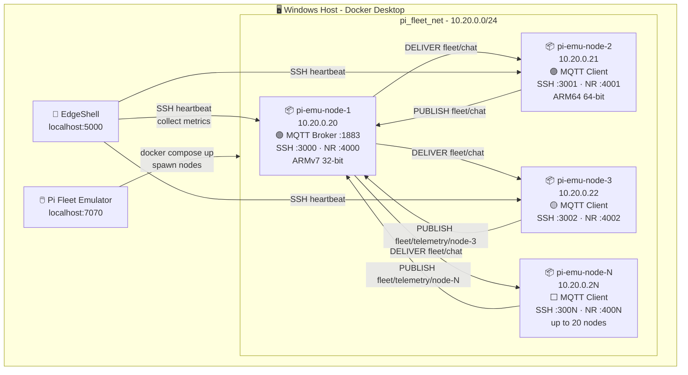
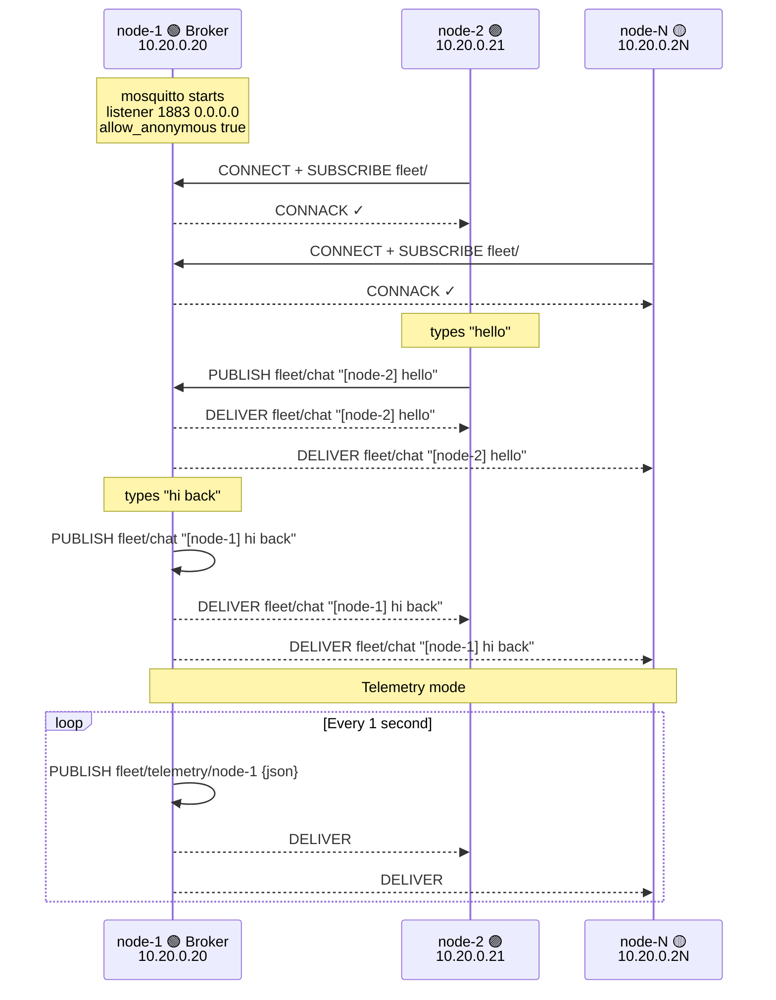
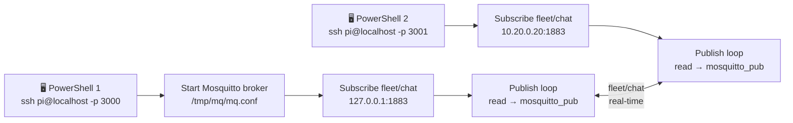
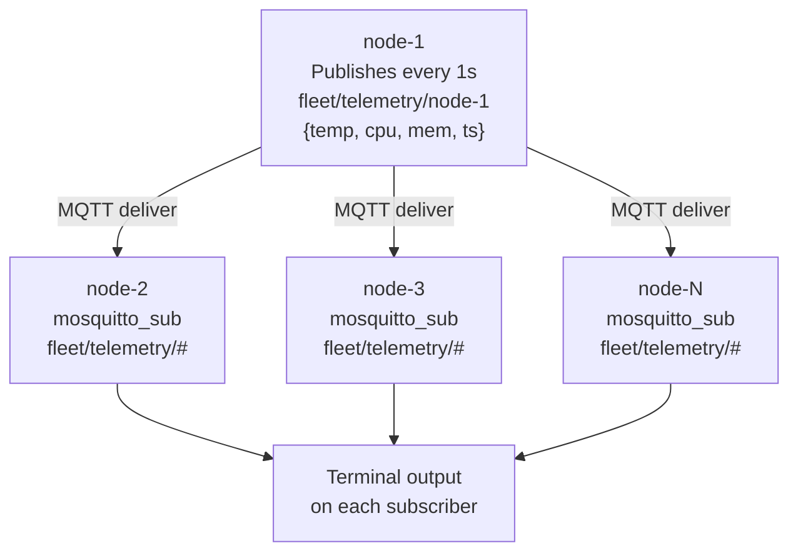
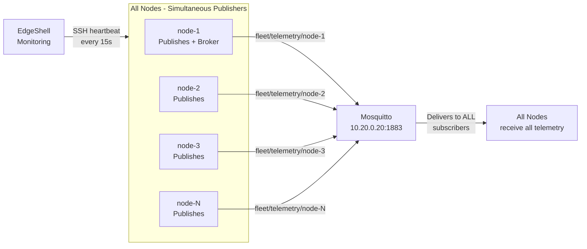

# Pi Fleet Emulator - Test Playground

[](.)
[](.)
[](.)
[](.)
[](.)

> **Validated test cases for simulated fleet communication.**
> Real MQTT pub/sub, inter-node telemetry, and bulk fleet messaging
> across emulated Raspberry Pi nodes - no hardware required.

---

## Table of Contents

- [Architecture](#architecture)
- [Prerequisites](#prerequisites)
- [Test Case 1 - Two-Node Chat Session](#test-case-1--two-node-chat-session)
- [Test Case 2 - Multi-Node Telemetry Broadcast](#test-case-2--multi-node-telemetry-broadcast)
- [Test Case 3 - Bulk Fleet Stress Simulation](#test-case-3--bulk-fleet-stress-simulation)
- [Resource Consumption Reference](#resource-consumption-reference)
- [Troubleshooting](#troubleshooting)

---

## Architecture

### Fleet Network Topology



### MQTT Message Flow



---

## Prerequisites

### Spawn the fleet

Open **http://localhost:7070** → add nodes → **Spawn Fleet**

Minimum: **2 nodes**. Recommended for full test: **3-5 nodes** (mix 32-bit and 64-bit).

### Verify containers running

```bash
docker ps --filter name=pi-emu
```

```
pi-emu-node-2   Up 3 minutes   0.0.0.0:3001->22/tcp, 0.0.0.0:4001->1880/tcp
pi-emu-node-1   Up 3 minutes   0.0.0.0:3000->22/tcp, 0.0.0.0:4000->1880/tcp
```

Every node ships with `mosquitto` and `mosquitto-clients` preinstalled - no extra setup needed.

### Credentials

```
User:     pi
Password: raspberry
```

---

## Test Case 1 - Two-Node Chat Session

> **Proves:** Real inter-container MQTT pub/sub. Both nodes send and receive simultaneously on a shared topic.



---

### Window 1 - Node 1 - Broker + Chat

```powershell
ssh pi@localhost -p 3000
```
*Password: raspberry*

```bash
pkill mosquitto 2>/dev/null; sleep 1
mkdir -p /tmp/mq
cat > /tmp/mq/mq.conf << 'EOF'
listener 1883 0.0.0.0
allow_anonymous true
EOF
mosquitto -c /tmp/mq/mq.conf &
sleep 1
echo "Broker up on $(hostname -I | awk '{print $1}'):1883"
mosquitto_sub -h 127.0.0.1 -p 1883 -t fleet/chat &
while true; do
  read -p $'\n[node-1]> ' m
  mosquitto_pub -h 127.0.0.1 -p 1883 -t fleet/chat -m "[node-1] $m"
done
```

Wait for `[node-1]>` before opening Window 2.

---

### Window 2 - Node 2 - Client + Chat

```powershell
ssh pi@localhost -p 3001
```
*Password: raspberry*

```bash
pkill mosquitto_sub 2>/dev/null; sleep 1
mosquitto_sub -h 10.20.0.20 -p 1883 -t fleet/chat &
while true; do
  read -p $'\n[node-2]> ' m
  mosquitto_pub -h 10.20.0.20 -p 1883 -t fleet/chat -m "[node-2] $m"
done
```

### Expected output

**Node 1:**
```
Broker up on 10.20.0.20:1883
[node-1]>
fleet/chat [node-2] hello from node 2
[node-1]> hi back!
fleet/chat [node-1] hi back!
```

**Node 2:**
```
[node-2]> hello from node 2
fleet/chat [node-2] hello from node 2
fleet/chat [node-1] hi back!
[node-2]>
```

**Stop:** `Ctrl+C` on both windows.

---

## Test Case 2 - Multi-Node Telemetry Broadcast

> **Proves:** One publisher sends structured JSON sensor data every second. All subscriber nodes receive it - replicating a real IoT pipeline.



### Node 1 - Start broker + publish telemetry

```bash
pkill mosquitto 2>/dev/null; sleep 1
mkdir -p /tmp/mq
cat > /tmp/mq/mq.conf << 'EOF'
listener 1883 0.0.0.0
allow_anonymous true
EOF
mosquitto -c /tmp/mq/mq.conf &
sleep 1

while true; do
  CPU=$(awk '{printf "%d", $1*100}' /proc/loadavg)
  MEM=$(free | awk '/Mem/{printf "%d", $3/$2*100}')
  TEMP=$((40 + RANDOM % 25))
  TS=$(date -u +%s)
  MSG="{\"node\":\"node-1\",\"temp\":$TEMP,\"cpu\":$CPU,\"mem\":$MEM,\"ts\":$TS}"
  mosquitto_pub -h 127.0.0.1 -p 1883 -t fleet/telemetry/node-1 -m "$MSG"
  echo "$MSG"
  sleep 1
done
```

### All other nodes - subscribe

```bash
# Run this on node-2, node-3, node-N
mosquitto_sub -h 10.20.0.20 -p 1883 -t "fleet/telemetry/#" -v
```

### Expected output on subscribers

```
fleet/telemetry/node-1 {"node":"node-1","temp":53,"cpu":4,"mem":68,"ts":1783606900}
fleet/telemetry/node-1 {"node":"node-1","temp":51,"cpu":2,"mem":69,"ts":1783606901}
fleet/telemetry/node-1 {"node":"node-1","temp":57,"cpu":5,"mem":68,"ts":1783606902}
```

**Stop:** `Ctrl+C` on all nodes.

---

## Test Case 3 - Bulk Fleet Stress Simulation

> **Proves:** All nodes publish simultaneously to the same broker. Demonstrates concurrent connections and message throughput. EdgeShell monitors resources fleet-wide while traffic runs.



### Step 1 - Via EdgeShell Terminal (all nodes at once)

In EdgeShell → **Terminal** → select **all nodes** → send:

```bash
sudo apt install -y mosquitto-clients -qq 2>/dev/null && echo "Ready: $(hostname)"
```

### Step 2 - Select all nodes EXCEPT node-1, send:

```bash
NODE=$(hostname)
BROKER=10.20.0.20
for i in $(seq 1 20); do
  CPU=$(awk '{printf "%d", $1*100}' /proc/loadavg)
  MEM=$(free | awk '/Mem/{printf "%d", $3/$2*100}')
  TEMP=$((38 + RANDOM % 28))
  mosquitto_pub -h $BROKER -p 1883 \
    -t "fleet/telemetry/$NODE" \
    -m "{\"node\":\"$NODE\",\"temp\":$TEMP,\"cpu\":$CPU,\"mem\":$MEM,\"seq\":$i}" \
    2>/dev/null
  sleep 1
done
echo "Done: 20 messages sent from $NODE"
```

### Step 3 - Monitor all nodes simultaneously

While traffic runs, in EdgeShell → **Monitoring** → click **Refresh All**.

Or via Terminal, select all nodes:

```bash
echo "=== $(hostname) $(date -u +%H:%M:%S) ===" \
  && cat /proc/loadavg \
  && free -h | grep Mem
```

### Step 4 - Subscribe to all telemetry on node-1

```bash
# On node-1
mosquitto_sub -h 127.0.0.1 -p 1883 -t "fleet/telemetry/#" -v
```

You will see telemetry from every node arriving simultaneously:

```
fleet/telemetry/pi-emu-node-2 {"node":"pi-emu-node-2","temp":44,"cpu":3,"mem":71,"seq":1}
fleet/telemetry/pi-emu-node-3 {"node":"pi-emu-node-3","temp":51,"cpu":2,"mem":69,"seq":1}
fleet/telemetry/pi-emu-node-4 {"node":"pi-emu-node-4","temp":47,"cpu":4,"mem":72,"seq":1}
fleet/telemetry/pi-emu-node-2 {"node":"pi-emu-node-2","temp":46,"cpu":3,"mem":71,"seq":2}
```

---

## Resource Consumption Reference

Measured during validated test runs on Windows 11, Docker Desktop, 16GB RAM:

| Scenario | CPU per node | RAM per node | Network |
|---|---|---|---|
| Idle - SSH only | < 1% | ~80 MB | negligible |
| Chat session (2 nodes) | 2-5% | ~90 MB | < 1 KB/s |
| Telemetry 1 msg/s | 3-8% | ~95 MB | ~2 KB/s |
| Bulk stress - all nodes | 10-25% | ~100 MB | ~10 KB/s |
| Node-RED active | 15-30% | ~120 MB | ~5 KB/s |
| EdgeShell heartbeat | +1-3% | +5 MB | ~0.5 KB/s |

---

## Troubleshooting

| Error | Cause | Fix |
|---|---|---|
| `Connection refused` from node-2 | Broker not on `0.0.0.0` | Use exact broker command with `/tmp/mq/mq.conf` config |
| `systemctl: simulated` | Fake systemctl in container | Start mosquitto directly: `mosquitto -c /tmp/mq/mq.conf &` |
| Subscriber exits instantly | Node-2 had its own Mosquitto | Run `pkill mosquitto` on node-2 before subscribing |
| No messages on subscriber | Wrong broker IP | Get correct IP with `hostname -I` on node-1 |
| `ping: command not found` | Not in slim image | Use `hostname -I` instead - ping not needed |
| Messages only echo locally | Node-1 subscriber missing | Re-run node-1 block - include the `mosquitto_sub &` line |
| Broker won't start | Port 1883 in use | Run `pkill mosquitto; sleep 1` then restart |

---

## Key Takeaways

This playground validates that Pi Fleet Emulator faithfully replicates a real Raspberry Pi fleet for:

- **Real MQTT networking** - identical to physical Pi nodes on a LAN
- **Cross-architecture fleet** - 32-bit ARMv7 and 64-bit ARM64 nodes co-existing
- **Concurrent pub/sub** - multiple publishers, multiple subscribers, zero collision
- **EdgeShell integration** - deploy, monitor, and execute across all nodes while MQTT traffic runs
- **Production IoT pattern** - sensor → broker → gateway → cloud pipeline validated end-to-end

The only gap from real hardware is GPIO/camera. All networking, protocol, and software behaviour is genuine.

---

*Part of [Pi Fleet Emulator](README.md) · Works with EdgeShell*
